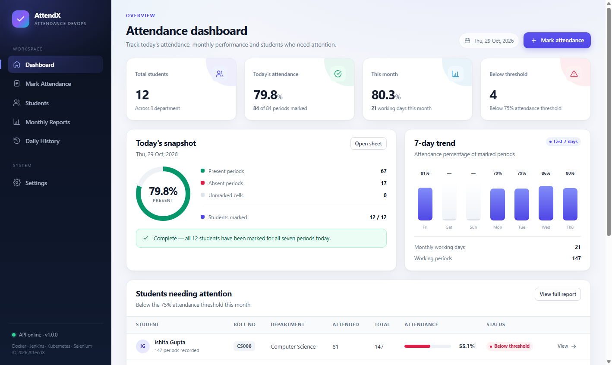

# AttendX — Student Attendance Management System

A complete web application for recording **seven-period daily attendance**, storing records **date-wise and period-wise**, and automatically calculating **monthly totals, percentages and low-attendance alerts**. The project also demonstrates an end-to-end DevOps workflow with **Git, Jenkins, Docker, Kubernetes and Selenium**.



## Contents

- [Features](#features)
- [Technology stack](#technology-stack)
- [Architecture](#architecture)
- [Project structure](#project-structure)
- [Quick start](#quick-start)
- [Using the application](#using-the-application)
- [API reference](#api-reference)
- [Automated tests](#automated-tests)
- [Docker](#docker)
- [Jenkins CI/CD](#jenkins-cicd)
- [Kubernetes](#kubernetes)
- [Git and GitHub](#git-and-github)
- [Verification checklist](#verification-checklist)
- [Detailed verification report](docs/VERIFICATION.md)
- [Troubleshooting](#troubleshooting)
- [License](#license)

## Features

### Attendance

- Seven attendance periods per student per day.
- Present/absent toggles for every period, with Mark All Present and Mark All Absent.
- Date picker for recording or correcting attendance on any working day.
- Saved registers reload from SQLite and can be corrected and saved again.
- Bulk save uses an upsert so duplicate student/date/period rows cannot be created.
- Clear an entire day's register when needed.

### Students

- Add, edit and delete students (roll number, name, department).
- Case-insensitive unique roll numbers and server-side validation.
- Search by roll number, name or department.
- Department filter and class list with live counts.

### Reports and analytics

- Monthly report with working days, working periods, periods attended, periods absent, total periods and attendance percentage.
- Configurable low-attendance threshold (default **75%**).
- Students below the threshold are highlighted and counted.
- Individual student drill-down with a day-wise register.
- Daily history with date-range filtering and attendance summaries.
- CSV export of the monthly report, including metadata and class totals.
- Dashboard with today's completion, monthly class percentage, low-attendance count and recent activity.

### DevOps and quality

- Persistent SQLite database with WAL mode and foreign-key cascades.
- Health endpoint used by Docker, Kubernetes and monitoring checks.
- API tests with Node's test runner and Supertest.
- Selenium WebDriver browser tests in headless Chrome.
- Production Dockerfile with a non-root runtime user and container health check.
- Jenkins pipeline for install, API tests, Docker build, persistence smoke test, Selenium E2E and optional Kubernetes deployment.
- Kubernetes Deployment, Service, PVC, readiness/liveness probes and persistence validation.
- Responsive UI with mobile navigation, keyboard-accessible modals and toast feedback.

## Technology stack

| Layer | Technology |
| --- | --- |
| Frontend | HTML5, CSS3, vanilla JavaScript (no build step) |
| Backend | Node.js 22.5+ / Express 5 |
| Database | SQLite via Node's built-in `node:sqlite` (`DatabaseSync`) |
| API tests | Node test runner + Supertest |
| Browser tests | Selenium WebDriver 4 + headless Chrome |
| Containers | Docker, Docker Compose |
| CI/CD | Jenkins LTS (portable WAR) + Pipeline |
| Orchestration | Kubernetes (Minikube, Docker driver) |
| Version control | Git / GitHub |

## Architecture

```text
                         +-----------------------------+
                         |  Browser (HTML/CSS/JS)      |
                         |  Dashboard, attendance,     |
                         |  students, reports, history |
                         +--------------+--------------+
                                        |
                                 HTTP / JSON, CSV
                                        |
                         +--------------v--------------+
                         |  Express 5 application       |
                         |  /api/* + static frontend    |
                         +--------------+--------------+
                                        |
                              node:sqlite (DatabaseSync)
                                        |
                         +--------------v--------------+
                         |  SQLite database + WAL       |
                         |  students / attendance /     |
                         |  settings                    |
                         +--------------+--------------+
                                        |
                     +------------------+------------------+
                     |                                     |
              Docker container                     Kubernetes Pod
              named volume                         PersistentVolumeClaim
```

The same Express process serves the API and the static frontend, so there is no separate frontend build or reverse proxy to configure.

## Project structure

```text
student attendance managment/
├── backend/
│   ├── app.js                 Express app, security headers, static files, error handling
│   ├── db.js                  Schema, validation, attendance/report queries, seed data
│   ├── seed.js                CLI to create or reset demo data
│   ├── server.js              HTTP server and graceful shutdown
│   └── routes/                students, attendance, reports, settings
├── frontend/
│   ├── index.html             Dashboard
│   ├── attendance.html        Seven-period daily register
│   ├── students.html          Student management
│   ├── reports.html           Monthly report and student drill-down
│   ├── history.html           Daily attendance history
│   ├── settings.html          Threshold and institution settings
│   ├── 404.html
│   ├── css/styles.css         Responsive design system
│   └── js/                    Shared helpers and page controllers
├── tests/
│   ├── api.test.js            14 API/integration tests
│   └── selenium/e2e.test.js   7 Selenium browser tests
├── k8s/                       Namespace, PVC, Deployment and Service
├── scripts/                   Local, Docker, Jenkins, Kubernetes and CI scripts
├── Dockerfile
├── docker-compose.yml
├── Jenkinsfile
├── package.json
└── README.md
```

## Quick start

### Prerequisites

- Node.js **22.5 or newer** (the project uses the built-in `node:sqlite` module; Node 24 is recommended).
- npm.
- Chrome (only for Selenium tests).
- Optional: Docker Desktop, Java 21, Jenkins, Minikube for the DevOps stages.

No native database driver, compiler or frontend toolchain is required.

### Install and run

```bat
cd /d "C:\devops\student attendance managment"
npm ci
npm start
```

Open <http://localhost:3000>. The server prints the URL, health endpoint and database path.

On Windows, the convenience scripts add the standard tool locations to `PATH` and run the server in the background:

```bat
scripts\start-local.cmd
scripts\stop-local.cmd
```

Logs are written to `logs/server.log` and `logs/server-error.log`.

### Demo data

When the database is empty, the app seeds:

- 12 students (`CS001`–`CS012`) across Computer Science.
- Weekday attendance for the previous month and the current month up to today.
- Seven periods per student per working day.
- A realistic spread of attendance percentages, including students below 75%.

To reset the database deliberately:

```bat
node backend/seed.js --force
```

The seed is skipped when `SEED_ON_EMPTY=false` or when `NODE_ENV=test`.

### Configuration

| Variable | Default | Purpose |
| --- | --- | --- |
| `PORT` | `3000` | HTTP port |
| `HOST` | `0.0.0.0` | Bind address |
| `DATA_DIR` | `./data` | Directory containing `attendance.db` |
| `SEED_ON_EMPTY` | `true` | Seed demo data when the database is empty |
| `NODE_ENV` | `development` | Runtime mode; `test` disables seeding |

The database file is `data/attendance.db`. Docker and Kubernetes use `/app/data`, backed by a volume or PVC.

## Using the application

| Page | What it does |
| --- | --- |
| **Dashboard** | Today's marked periods, class percentage, low-attendance count, month working days and recent activity. |
| **Attendance** | Pick a date, mark each student for periods 1–7, use Mark All Present/Absent, save or clear the day. |
| **Students** | Add, edit, delete and search students; filter by department. |
| **Reports** | Select a month, view class summary and per-student totals, open day-wise details and download CSV. |
| **History** | Choose a date range, review daily marked/absent/present totals and open the register for a date. |
| **Settings** | Change the low-attendance threshold (0–100) and institution name. |

### Attendance workflow

1. Open **Attendance** and choose a date.
2. Mark each student's seven periods (click a cell to cycle Present → Absent).
3. Use **Mark All Present** or **Mark All Absent** for the class, then correct individual cells.
4. Click **Save Attendance**. The footer confirms the saved date and time.
5. Reload the page or restart the server; the register is loaded from SQLite.

### Monthly calculation

For a selected month and student:

```text
total periods    = working days in the month × 7
periods attended = records marked present
periods absent   = records marked absent
percentage       = attended / (attended + absent) × 100
```

A student is below the threshold when their percentage is lower than the configured threshold (75% by default). The class percentage is calculated from all recorded periods in the month.

## API reference

Base URL: `http://localhost:3000`

| Method | Endpoint | Description |
| --- | --- | --- |
| `GET` | `/api/health` | Health and SQLite status |
| `GET` | `/api/dashboard` | Dashboard metrics, low-attendance list and recent activity |
| `GET` | `/api/students?search=&department=` | List/search students |
| `GET` | `/api/students/departments` | Distinct departments |
| `GET` | `/api/students/:id` | One student |
| `POST` | `/api/students` | Create a student |
| `PUT` | `/api/students/:id` | Update a student |
| `DELETE` | `/api/students/:id` | Delete a student and cascade attendance |
| `GET` | `/api/attendance?date=YYYY-MM-DD` | Daily register (defaults to today) |
| `POST` | `/api/attendance/bulk` | Save/upsert a date's records |
| `DELETE` | `/api/attendance/:date` | Clear a date's register |
| `GET` | `/api/reports/monthly?month=YYYY-MM&threshold=75` | Monthly class report |
| `GET` | `/api/reports/monthly.csv?month=YYYY-MM&threshold=75` | CSV export |
| `GET` | `/api/reports/student/:id?month=YYYY-MM` | Student month detail and day-wise rows |
| `GET` | `/api/reports/history?from=YYYY-MM-DD&to=YYYY-MM-DD` | Daily history |
| `GET` | `/api/settings` | Threshold and institution |
| `PUT` | `/api/settings` | Update settings |

Create a student:

```bash
curl -X POST http://localhost:3000/api/students \
  -H "Content-Type: application/json" \
  -d '{"rollNo":"CS013","name":"New Student","department":"Computer Science"}'
```

Save attendance:

```bash
curl -X POST http://localhost:3000/api/attendance/bulk \
  -H "Content-Type: application/json" \
  -d '{"date":"2026-10-29","records":[{"studentId":18,"periods":{"1":"present","2":"present","3":"absent","4":"present","5":"present","6":"present","7":"present"}}]}'
```

Use an ID returned by `GET /api/students`; in the clean demo database the first student (`CS001`) has ID `18`.

Errors use a consistent shape:

```json
{ "error": { "code": "DUPLICATE_ROLL_NO", "message": "Roll number CS001 already exists." } }
```

## Automated tests

### API and integration tests

```bat
npm test
```

14 tests cover health, empty state, student CRUD and validation, duplicate roll numbers, search/filter, daily register shape, bulk upsert/corrections, input validation, monthly calculations, threshold flags, CSV, history, settings, cascade deletion, clearing a date, on-disk persistence and error handling.

Generate a JUnit report for Jenkins:

```bat
npm run test:junit
```

Result: `reports/junit.xml`.

### Selenium browser tests

Start the app, then run:

```bat
npm run test:e2e
```

Or let the isolated wrapper start its own app on port 3200 with a temporary database:

```bat
scripts\run-e2e.cmd
```

Use demo data for richer screenshots:

```bat
scripts\run-e2e.cmd -SeedDemo
```

The 7 tests cover:

1. Dashboard loads live metrics and navigation.
2. A student can be added through the management modal.
3. Seven-period attendance can be marked, corrected and survives a page reload.
4. Monthly report includes the student, drill-down works and CSV export is valid.
5. Daily history filters a date range and shows the saved register.
6. Settings persist the attendance threshold.
7. Mobile navigation and layout remain usable.

Screenshots are written to `reports/screenshots/`. The committed copies under `docs/screenshots/` show the E2E workflow from the disposable test database; `99-final-state.png` is recaptured from the clean demo database.

## Docker

### Published images

The verified image is published to both registries:

| Registry | Image |
| --- | --- |
| Docker Hub | `keerthireddy010805/student-attendance:1.0.0` |
| GitHub Container Registry | `ghcr.io/keerthi-reddy01/student-attendance:1.0.0` |

```bat
docker pull keerthireddy010805/student-attendance:1.0.0
docker run -d --name student-attendance-app ^
  -p 3000:3000 ^
  -e SEED_ON_EMPTY=true ^
  -v attendance-data:/app/data ^
  keerthireddy010805/student-attendance:1.0.0
```

The `latest` tag points to the same image. Docker Hub: <https://hub.docker.com/r/keerthireddy010805/student-attendance>. The GHCR image is built and pushed automatically by `.github/workflows/docker-publish.yml` on every `main` push; the GitHub Actions run for commit `c074e1f` completed successfully.

### Build and run

```bat
docker build -t student-attendance:1.0.0 .
docker run -d --name student-attendance-app ^
  -p 3000:3000 ^
  -e SEED_ON_EMPTY=true ^
  -v attendance-data:/app/data ^
  student-attendance:1.0.0
```

Open <http://localhost:3000>. The container:

- Uses `node:24-alpine`.
- Installs production dependencies only.
- Runs as the non-root `node` user.
- Exposes port 3000.
- Has a `HEALTHCHECK` against `/api/health`.
- Stores SQLite data under `/app/data` in the named volume `attendance-data`.

Useful commands:

```bat
docker ps
docker logs -f student-attendance-app
docker inspect --format "{{.State.Health.Status}}" student-attendance-app
docker restart student-attendance-app
docker rm -f student-attendance-app
docker volume rm attendance-data
```

### Docker Compose

```bat
docker compose up -d --build
docker compose ps
docker compose logs -f
docker compose down
```

`docker compose down` keeps the named volume. Use `docker compose down -v` to delete the database as well.

### Persistence smoke test

The CI smoke script builds the image if needed, starts a disposable container on port 3100, creates a student through the API, restarts the container, verifies the student still exists through the same volume, then removes the container and volume:

```bat
scripts\run-docker-smoke.cmd
```

This verifies health, frontend serving, API writes and SQLite volume persistence.

## Jenkins CI/CD

The repository contains a declarative `Jenkinsfile`. Jenkins is installed as a **portable WAR** under `C:\devops\jenkins`, with its own Java 21 runtime, so no Windows service or administrator rights are required.

### Install Jenkins

```bat
scripts\install-jenkins.cmd
```

The installer:

1. Downloads Temurin JDK 21 into `C:\devops\jenkins\jdk21`.
2. Downloads the current Jenkins LTS WAR.
3. Uses the Jenkins Plugin Installation Manager to install `workflow-aggregator`, `git`, `junit`, `timestamper`, `pipeline-stage-view` and `ansicolor`.
4. Creates `JENKINS_HOME` at `C:\devops\jenkins\home`.
5. Creates the `admin` account and a full-control authorization strategy.
6. Creates the pipeline job **Attendance-Pipeline** using the GitHub repository URL.
7. Writes credentials to `C:\devops\jenkins\credentials.txt`.

### Start, open and stop

```bat
scripts\start-jenkins.cmd
scripts\stop-jenkins.cmd
```

- URL: <http://localhost:8080>
- Job: <http://localhost:8080/job/Attendance-Pipeline>
- Username/password: `C:\devops\jenkins\credentials.txt`
- Logs: `C:\devops\jenkins\logs\jenkins.log`

### Security

The installer enables Jenkins' built-in security:

- `HudsonPrivateSecurityRealm` creates the `admin` account.
- `FullControlOnceLoggedInAuthorizationStrategy` grants full control to authenticated users and disables anonymous read access.
- Anonymous requests to the dashboard, job API and build pages return **HTTP 403** and are redirected to the sign-in page; authenticated API requests return **HTTP 200**.
- The initial security script is written as ASCII without a BOM so Jenkins applies it on startup.

Credentials are stored outside the repository in `C:\devops\jenkins\credentials.txt`. This is suitable for a local demonstration only; use a secret manager and HTTPS for any shared deployment.

### Pipeline stages

| Stage | What it validates |
| --- | --- |
| Toolchain | Node, npm and Docker are reachable |
| Install dependencies | `npm ci` reproduces the lockfile install |
| API tests | 14 tests, JUnit published to Jenkins |
| Docker image | Production image builds successfully |
| Docker persistence smoke test | Container health, API write and SQLite volume survives a restart |
| Selenium E2E tests | Isolated app on port 3200; 7 browser tests |
| Kubernetes deploy (optional) | Deploys the image, waits for rollout/probes, validates NodePort, service health and PVC persistence after a pod reschedule |

Screenshots, JUnit results and logs are archived on every build.

### Trigger a build

From the Jenkins UI: open **Attendance-Pipeline** → **Build with Parameters** → optionally enable `DEPLOY_K8S` → **Build**.

From the command line:

```bat
scripts\trigger-jenkins.cmd
scripts\trigger-jenkins.cmd -DeployK8s
```

The trigger script authenticates with the credentials file, requests a CSRF crumb, queues the build, waits for completion, prints the result and saves the console log under `reports/jenkins-build-<number>.log`.

> Jenkins checks out the repository from the GitHub URL configured in the job. For a private repository, add a **Username with password** credential and select it in the job's SCM configuration.

## Kubernetes

The manifests in `k8s/` deploy one replica with a PersistentVolumeClaim:

- `namespace.yaml` — `attendance` namespace.
- `pvc.yaml` — 1 GiB `ReadWriteOnce` claim for SQLite.
- `deployment.yaml` — `student-attendance:1.0.0`, non-root user, readiness/liveness probes against `/api/health`, resource requests/limits, `Recreate` strategy for RWO safety.
- `service.yaml` — ClusterIP service exposed as NodePort **30080** on port 80 → container port 3000.

### Install Minikube

```bat
scripts\install-minikube.cmd
```

This downloads `minikube.exe` into `%LOCALAPPDATA%\Programs\Minikube`.

### Deploy and verify

```bat
scripts\deploy-k8s.cmd
```

The script:

1. Starts Minikube with the Docker driver if it is not running.
2. Builds the image if necessary and loads it into Minikube.
3. Applies the namespace, PVC, Deployment and Service.
4. Waits for the rollout and verifies NodePort 30080.
5. Port-forwards the service to `localhost:8081` and checks `/api/health`.
6. Creates a student through the Kubernetes service.
7. Deletes the pod, waits for the replacement pod, and verifies the student still exists through the PVC.
8. Removes the smoke-test student and leaves the Deployment running.

Access the deployed app:

```bat
kubectl -n attendance port-forward svc/attendance-service 8081:80
```

Then open <http://localhost:8081>.

Useful checks:

```bat
kubectl -n attendance get pods,svc,pvc
kubectl -n attendance rollout status deployment/attendance-app
kubectl -n attendance logs deployment/attendance-app
```

> The NodePort is reachable inside the Minikube network. On Windows with the Docker driver, use `kubectl port-forward` or `minikube service attendance-service -n attendance` for host access.

## Git and GitHub

The project is published at <https://github.com/keerthi-reddy01/student-attendance-managment-> on the `main` branch. The `origin` remote is already configured.

```bat
git status
git log --oneline
git push
```

To publish a copy to another account, create an empty repository (do **not** initialize it with a README), then run:

```bat
git remote set-url origin https://github.com/<your-account>/<repository>.git
git branch -M main
git push -u origin main
```

Use a GitHub Personal Access Token, Git Credential Manager or GitHub CLI for authentication. Never commit tokens, `data/`, `reports/` or `logs/`; they are excluded by `.gitignore`.

The Jenkins job **Attendance-Pipeline** is configured to check out the GitHub repository directly. For a private repository, add a **Username with password** credential in Jenkins and select it in the job's SCM configuration.

## Verification checklist

Verified on **2026-10-29**. Full command output and environment details are in [docs/VERIFICATION.md](docs/VERIFICATION.md).

| Area | Check | Result |
| --- | --- | --- |
| Application | Server boots, dashboard and all pages load | PASS |
| API | 14/14 Supertest integration tests | PASS |
| Live API | `npm run verify` — 9/9 read-only checks against port 3000 | PASS |
| Selenium | 7/7 headless Chrome E2E tests | PASS |
| Attendance | Seven periods, corrections, reload persistence | PASS |
| Monthly report | Totals, percentages, threshold flags, CSV | PASS |
| Docker | Build, non-root runtime, health check, API write | PASS |
| Docker registry | Docker Hub and GHCR `1.0.0`/`latest` images published and manifest-verified | PASS |
| Docker persistence | Record survives container restart via named volume | PASS |
| Jenkins | Portable install, plugins, pipeline job | PASS |
| Jenkins security | Anonymous API access denied (403), authenticated access allowed (200) | PASS |
| GitHub | Full history pushed to `keerthi-reddy01/student-attendance-managment-` | PASS |
| Jenkins pipeline | Build #7 SUCCESS; 14/14 API tests, Docker smoke, 7/7 Selenium, Kubernetes deploy | PASS |
| Kubernetes | Deployment, Service, NodePort 30080, readiness/liveness probes | PASS |
| Kubernetes persistence | Record survives pod reschedule via 1 GiB PVC | PASS |
| Kubernetes live data | 12 students and threshold 75 after smoke-test cleanup | PASS |
| Demo data | 12 students, 43 working dates, 3,612 attendance rows, threshold 75, 4 low-attendance students | PASS |

## Troubleshooting

### Port already in use

```bat
scripts\stop-local.cmd
```

or choose another port:

```bat
set PORT=3001
npm start
```

The Docker smoke test uses port 3100, the isolated Selenium run uses 3200, Jenkins uses 8080 and the Kubernetes port-forward uses 8081. Stop the conflicting process or change the relevant script parameter.

### `node:sqlite` not found

Use Node.js 22.5+ (Node 24 recommended). Check with `node --version`. The project intentionally uses the built-in SQLite module to avoid native compilation.

### Docker Desktop is not running

Start Docker Desktop and wait for the engine to become healthy:

```bat
docker info
```

Then rerun `scripts\run-docker-smoke.cmd` or `docker compose up -d --build`.

### Jenkins does not start

- Confirm `C:\devops\jenkins\jdk21\bin\java.exe` exists.
- Check `C:\devops\jenkins\logs\jenkins.log`.
- Jenkins requires Java 21+; the system Java 17 installation is not used.
- If port 8080 is busy, stop the conflicting process or start Jenkins on another port and update the job/credentials URL accordingly.

### Jenkins build cannot find the repository

The pre-created job uses `https://github.com/keerthi-reddy01/student-attendance-managment-.git`. Confirm the repository has a `main` branch and at least one commit:

```bat
git log --oneline -1
```

After moving the project, update the job's SCM URL.

### Jenkins security settings were not applied

Jenkins init scripts must be valid Groovy and must not start with a UTF-8 BOM. Check and rewrite the security script, then restart Jenkins:

```bat
node scripts\check-bytes.js C:\devops\jenkins\home\init.groovy.d\01-security.groovy
node scripts\strip-bom.js C:\devops\jenkins\home\init.groovy.d\01-security.groovy
scripts\stop-jenkins.cmd
scripts\start-jenkins.cmd
```

The `install-jenkins.ps1` script now writes this file as ASCII, so a fresh installation does not have the problem.

### Minikube or Kubernetes errors

```bat
minikube status
kubectl -n attendance get pods
kubectl -n attendance describe pod -l app=attendance
kubectl -n attendance logs -l app=attendance --tail=100
```

If the PVC or pod has permission errors, delete the namespace and redeploy:

```bat
kubectl delete namespace attendance
scripts\deploy-k8s.cmd
```

### Selenium cannot find Chrome

Install Google Chrome, or set `CHROME_PATH` to the Chrome executable before running the tests. The E2E test defaults to `C:\Program Files\Google\Chrome\Application\chrome.exe`.

## Security notes

This is a teaching/demonstration project. Before production use:

- Add authentication and role-based authorization for faculty/admin users.
- Serve over HTTPS and set a strict Content-Security-Policy.
- Use a managed database with backups rather than a single SQLite file.
- Store Jenkins and GitHub credentials in a secret manager, not a local text file.
- Restrict the Jenkins URL and API to trusted networks.
- Add rate limiting and audit logging for attendance corrections.

## License

MIT. See the project document for the original academic requirements.
